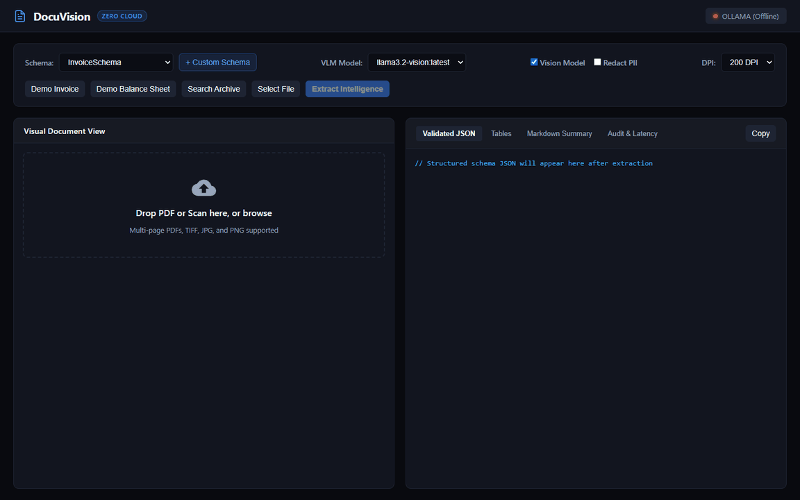
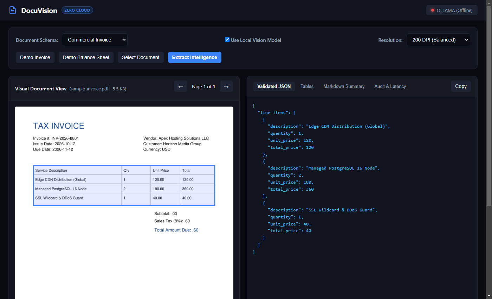
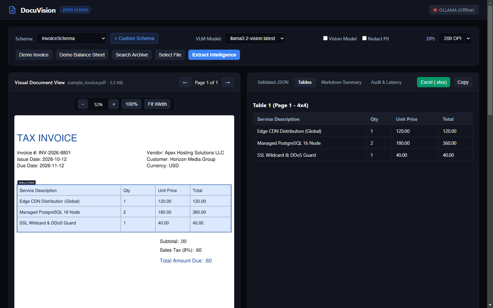
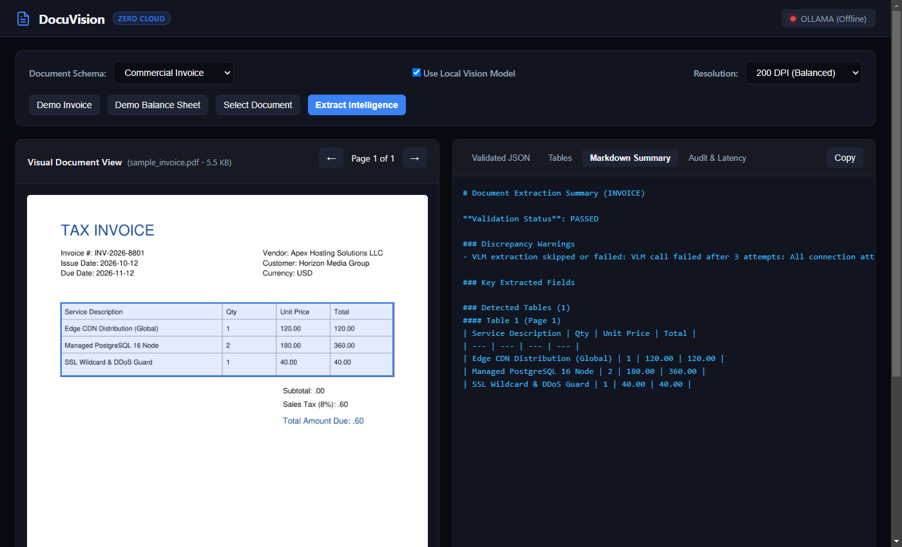
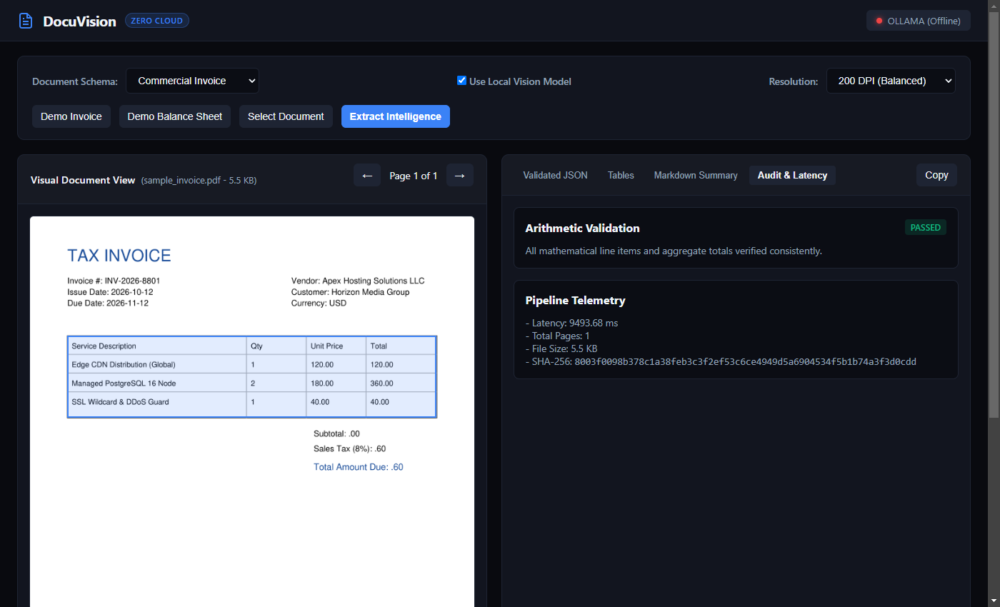

# DocuVision

Zero-cloud, high-fidelity multimodal document intelligence and structured schema extraction pipeline powered by local Vision-Language Models.

DocuVision converts multi-page PDFs, scans, receipts, invoices, and complex balance sheets into validated JSON and Markdown tables without sending a single byte of sensitive document data to external cloud APIs.

```
       +-------------------------------------------------------------+
       |                  Incoming PDF / Scan / Image                 |
       +-------------------------------------------------------------+
                                      |
                                      v
       +-------------------------------------------------------------+
       |               PyMuPDF Authentic Rasterizer                  |
       |  - Adaptive DPI rendering (150-600 DPI)                     |
       |  - Color preservation & memory-efficient streaming          |
       |  - Aspect-ratio safe scaling & bounding box normalization    |
       +-------------------------------------------------------------+
                                      |
                     +----------------+----------------+
                     |                                 |
                     v                                 v
       +----------------------------+    +----------------------------+
       | Deterministic Table Engine |    |    Local Multimodal VLM    |
       | - Vector line & grid rules |    | - Ollama / vLLM / LM Studio|
       | - Header & cell detection  |    | - Multimodal page prompts  |
       | - Markdown & CSV exporters |    | - Guided JSON schema output|
       +----------------------------+    +----------------------------+
                     |                                 |
                     +----------------+----------------+
                                      |
                                      v
       +-------------------------------------------------------------+
       |                Reconciliation & Parser Engine               |
       |  - Table-to-summary cross validation                        |
       |  - Arithmetic reconciliation (quantity * unit price == total)|
       |  - Strict Pydantic schema validation & error logging        |
       +-------------------------------------------------------------+
                                      |
                                      v
             [ Validated JSON ]  +  [ Markdown Tables ]
```



---

## Features

- **Zero cloud exposure**: All rasterization, table parsing, and inference execute locally using Ollama, vLLM, or OpenAI-compatible local runtimes like LM Studio.
- **Authentic PDF rasterizer**: Direct PyMuPDF rendering engine with configurable DPI, page streaming, and normalized bounding box mapping.
- **Dual-mode table extractor & stitcher**: Combines deterministic vector grid parsing with vision-assisted structural inference, plus automatic multi-page table continuity merging.
- **Multi-sheet Excel export**: Compiles extraction results into styled `.xlsx` workbooks across Overview, Extracted Tables, and Audit sheets with openpyxl.
- **Batch processing engine**: Concurrently processes directories of documents (`docuvision batch`) generating consolidated CSV and JSON summaries.
- **Privacy & PII redaction**: Automatically masks credit cards, SSN, and sensitive taxpayer codes directly on the document canvas before extraction.
- **Custom schema designer**: Interactively design, register, and persist user-defined schemas without writing Python code.
- **Arithmetic reconciliation**: Verifies line item totals, tax calculations, and subtotal consistency against extracted aggregate figures.
- **Interactive Web Studio**: Built-in FastAPI interface providing split-screen document preview, interactive bounding boxes, zoom and pan canvas, and live JSON inspector.
- **Rich terminal CLI**: Built with Typer and Rich, supporting batch processing, model diagnostics, and table previews directly in the console.

---

## Quickstart

### Prerequisites

- Python 3.10 or higher
- A running local VLM instance (for example, Ollama with `llama3.2-vision:latest` or `qwen2-vl:7b`)

```bash
# Pull a local vision model using Ollama
ollama run llama3.2-vision:latest
```

### Installation

Clone the repository and install dependencies in editable mode:

```bash
git clone https://github.com/alexandrmotologa/docuvision.git
cd docuvision
python -m venv .venv
source .venv/bin/activate  # On Windows: .venv\Scripts\activate
pip install -e ".[dev]"
```

### Command Line Interface

```bash
# Check local environment and VLM connectivity
docuvision check

# Extract structured invoice data to JSON
docuvision extract sample_invoice.pdf --schema invoice --format json --output invoice_data.json

# Extract structured data to a styled multi-sheet Excel workbook with PII redaction
docuvision extract sample_invoice.pdf --schema invoice --format excel --output invoice_report.xlsx --redact-pii

# Concurrently process an entire folder of scans
docuvision batch ./scans/ --schema invoice --output-dir ./outputs/batch --workers 4 --format all

# Extract all detected tables to Markdown
docuvision tables financial_report.pdf --format markdown

# Render document pages to high-resolution PNG images
docuvision rasterize document.pdf --dpi 300 --out-dir ./pages

# Launch the interactive Web Studio
docuvision serve --port 8000
```

---

## Interactive Web Studio

DocuVision includes a local web studio for inspecting documents, verifying bounding boxes, and validating extracted records.

Start the studio:

```bash
docuvision serve --host 127.0.0.1 --port 8000
```

Then open `http://localhost:8000` in your web browser. The studio provides:

1. Drag and drop file ingestion for PDFs and image scans.
2. Interactive zoom and pan viewport with 100% reset and fit-to-width.
3. Interactive bounding box overlays with hover tooltips and bidirectional row highlighting.
4. Custom Schema Designer modal for creating ad-hoc schemas on the fly.
5. Multi-sheet Excel workbook download button.
6. PII redaction toggle for zero-cloud privacy compliance.

| Validated JSON & Bounding Boxes | Rendered Tables View |
| :---: | :---: |
|  |  |

| Markdown Summary | Arithmetic Reconciliation |
| :---: | :---: |
|  |  |

---

## Configuration

Configure DocuVision via environment variables or a `.env` file in the project root:

| Variable | Default | Description |
| :--- | :--- | :--- |
| `DOCUVISION_VLM_PROVIDER` | `ollama` | Provider backend: `ollama`, `openai_compatible`, `vllm`, or `direct` |
| `DOCUVISION_VLM_BASE_URL` | `http://localhost:11434` | Base endpoint of the local model server |
| `DOCUVISION_VLM_MODEL` | `llama3.2-vision:latest` | Vision model tag or name |
| `DOCUVISION_RASTER_DPI` | `200` | Resolution for PDF page rendering |
| `DOCUVISION_RASTER_MAX_DIM` | `2048` | Maximum pixel width or height to preserve VLM context window |
| `DOCUVISION_TABLE_EXTRACTION_MODE` | `hybrid` | Strategy: `hybrid`, `deterministic`, or `vlm` |
| `DOCUVISION_ENABLE_LINE_ITEM_MATH_CHECK` | `true` | Enforces mathematical consistency on line items |

---

## Supported Schemas

DocuVision ships with typed Pydantic models for common document types:

- `invoice`: Vendor information, customer details, line items (qty, price, total), tax rates, currency, payment terms.
- `receipt`: Merchant name, transaction date and time, line items, tip, tax, final total, payment method.
- `balance_sheet`: Reporting period, assets (current and non-current), liabilities, equity breakdown, accounting balance check.
- `lab_report`: Patient details, specimen collection date, test panels, measured values, units, reference intervals, abnormal flags.
- `generic`: Dynamic key-value pair and entity extractor with summary generation.

Custom schemas can be passed as standard Pydantic models in Python or registered in the schema catalog.

---

## Python API Usage

```python
from pathlib import Path
from docuvision.pipeline import DocumentPipeline
from docuvision.core.config import DocuVisionSettings

settings = DocuVisionSettings(
    vlm_provider="ollama",
    vlm_base_url="http://localhost:11434",
    vlm_model="llama3.2-vision:latest",
)

pipeline = DocumentPipeline(settings=settings)

# Process a document with the invoice schema
result = pipeline.process(
    file_path=Path("sample_invoice.pdf"),
    schema_name="invoice",
)

# Inspect validated JSON payload
print("Extracted invoice number:", result.structured_data.get("invoice_number"))
print("Extracted total:", result.structured_data.get("total_amount"))

# Print extracted tables in Markdown
for table in result.tables:
    print(table.markdown)
```

---

## Architecture and Engineering Details

### Rasterization Pipeline
The rasterizer wraps PyMuPDF (`fitz`), utilizing matrix transforms to render vector PDFs directly into pixel buffers at target DPI. Pages exceeding maximum pixel bounds are scaled proportionally to protect local VLM context buffers while retaining optical clarity.

### Table Extraction
DocuVision analyzes vector drawing commands, line intersections, and text clusters on each page. Cells are reconstructed into a connected grid matrix, generating both Markdown and CSV exports with column span handling.

### Arithmetic Reconciliation
When extracting invoices or receipts, DocuVision compares the sum of individual table line items against extracted aggregate fields (`subtotal`, `tax_amount`, `total_amount`). Minor floating point deviations are flagged in the validation report.

---

## Testing

Run the automated test suite with pytest:

```bash
pytest -v
```

---

## License

Apache-2.0
